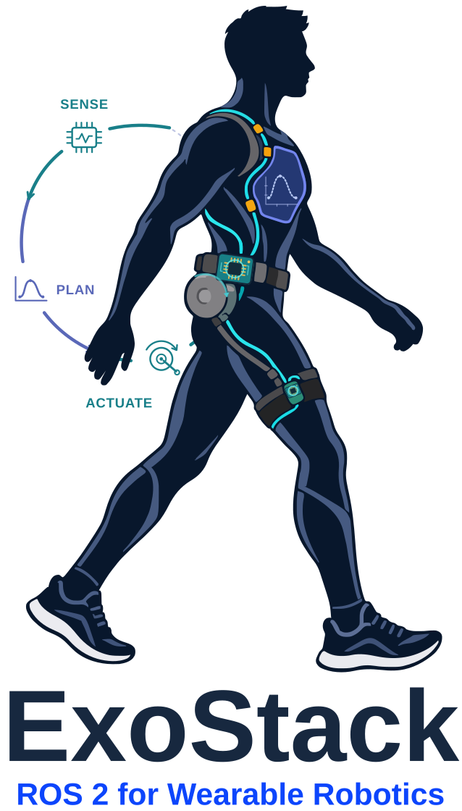
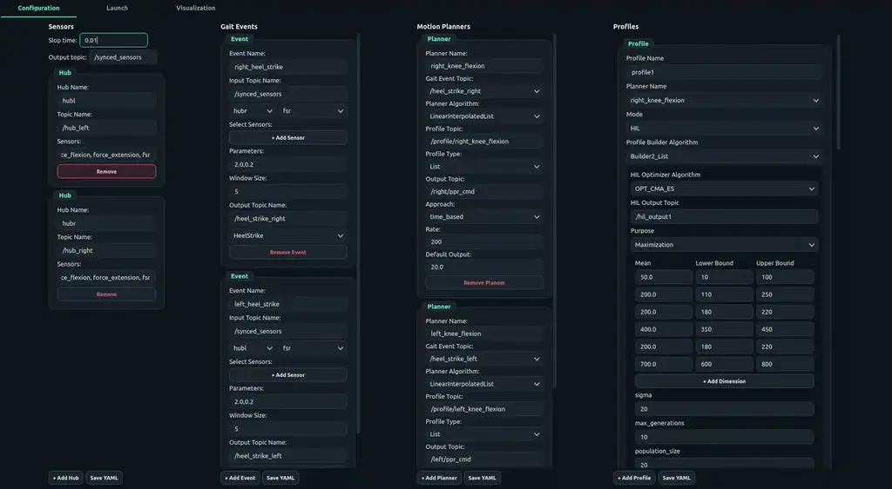
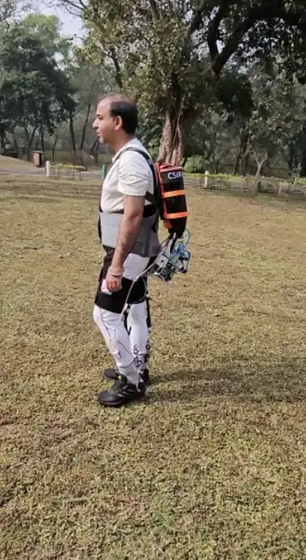
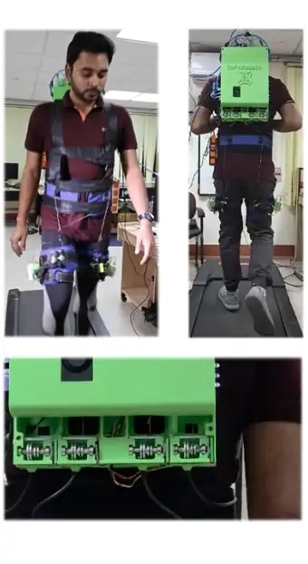
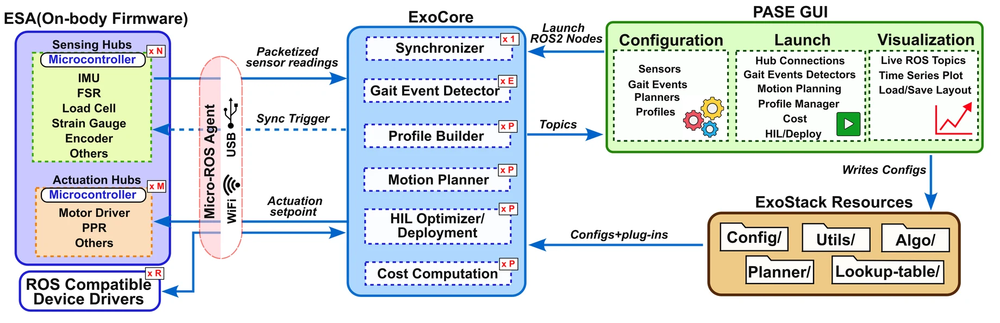
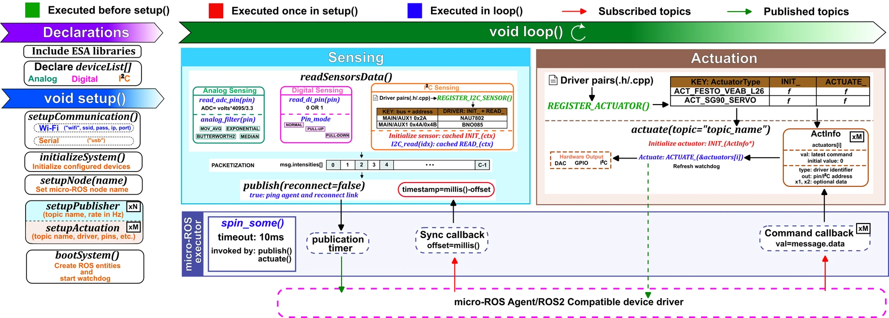
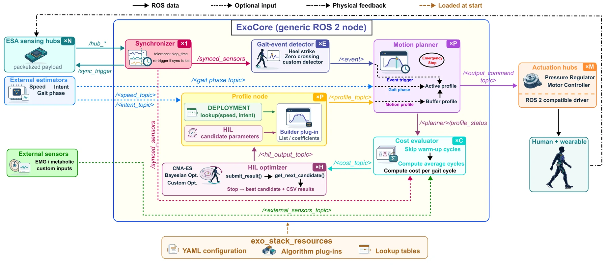

<p align="center">
  <picture>
    <source media="(prefers-color-scheme: dark)" srcset="docs/assets/img/hero-dark.svg">
    <source media="(prefers-color-scheme: light)" srcset="docs/assets/img/hero.svg">
    
  </picture>
</p>

<p align="center">
  <b>A modular and reconfigurable software framework for wearable robotics using ROS&nbsp;2</b><br>
  <sub>embedded sensing and actuation &nbsp;·&nbsp; configuration-driven ROS&nbsp;2 nodes &nbsp;·&nbsp; human-in-the-loop personalization &nbsp;·&nbsp; GUI</sub>
</p>

<p align="center">
  <a href="https://arxiv.org/abs/[ARXIV_ID]"></a>
  <a href="https://doi.org/10.48550/arXiv.[ARXIV_ID]"></a>
  <a href="https://debadrata.github.io/ExoStack_documentation/"></a>
  <a href="docs/ExoStack_User_Manual.pdf"></a>
  <a href="LICENSE"></a>
  <a href="LICENSE-DOCS.md"></a>
  <br>
  
  
  
  
  
</p>

<p align="center">
  <b><a href="https://www.linkedin.com/in/debadrata-sarkar">Debadrata Sarkar</a></b>, <b>Soumen Sen</b>, <b><a href="https://www.linkedin.com/in/dr-aman-arora/">Aman Arora</a></b><br>
  Human Centred Robotics and Cybernetics Group, CSIR–Central Mechanical Engineering Research Institute (CSIR-CMERI), Durgapur, India
</p>

<p align="center">
  <a href="mailto:deba00126@gmail.com"></a>
  <a href="https://www.linkedin.com/in/debadrata-sarkar"></a>
  <a href="https://dsarkarrobotics.com"></a>
</p>

<h3 align="center">
  <a href="https://arxiv.org/abs/[ARXIV_ID]">📄 Paper</a> &nbsp;•&nbsp;
  <a href="https://debadrata.github.io/ExoStack_documentation/">📘 Documentation</a> &nbsp;•&nbsp;
  <a href="docs/ExoStack_User_Manual.pdf">📗 User manual</a> &nbsp;•&nbsp;
  <a href="#validated-on-two-exosuits">🎥 Videos</a>
</h3>

> [!NOTE]
> **📘 Full documentation: [ExoStack documentation website](https://debadrata.github.io/ExoStack_documentation/)**: installation, every configuration file, the GUI, and step-by-step guides for adding your own sensors, actuators and algorithms. The same content is available offline as the [user manual (PDF)](docs/ExoStack_User_Manual.pdf).

<p align="center">
  <br>
  <sub><i>PASE, the ExoStack GUI: configure the stack, launch every stage, and plot any signal live.</i></sub>
</p>

<p align="center">
  <a href="#validated-on-two-exosuits">Validation</a> ·
  <a href="#overview">Overview</a> ·
  <a href="#architecture">Architecture</a> ·
  <a href="#repository-structure">Repository</a> ·
  <a href="#installation">Installation</a> ·
  <a href="#quick-start">Quick start</a> ·
  <a href="#documentation">Documentation</a> ·
  <a href="#citation">Citation</a>
</p>

---

## Validated on two exosuits

<table align="center">
  <tr>
    <td align="center"><br><sub><b>SoftEXOwalk</b>: knee-flexion exosuit;<br>assistance personalized by Bayesian HIL optimization</sub></td>
    <td align="center"><br><sub><b>Hip flexion–extension exosuit</b>;<br>assistance personalized by CMA-ES</sub></td>
  </tr>
</table>

Both systems run the same ExoStack code; they differ only in their device lists, configuration files and plug-ins. Results are reported in the [paper](https://arxiv.org/abs/[ARXIV_ID]).

## Overview

Every wearable-robot study rebuilds the same software: drivers for body-worn sensors, time alignment across boards, gait-event detection, assistance profiles, actuator commands, and, increasingly, the machinery of human-in-the-loop (HIL) optimization. **ExoStack provides this pipeline as a ready, open framework**, from the microcontrollers on the body to the ROS&nbsp;2 nodes on the host.

<p align="center">
  <a href="docs/images/exostack_overview.png"></a>
</p>

| Component | Runs on | What it does |
|---|---|---|
| [**ESA**](ESA): Embedded Sensing and Actuation | ESP32 boards on the body | Turns each board into a micro-ROS sensing or actuation hub, declared by a device list |
| [**ExoCore**](exo_stack) (`exo_stack`) | Host PC or Jetson, ROS&nbsp;2 Humble | Generic nodes for synchronization, gait events, assistance profiles, motion planning, cost and HIL optimization |
| [**exo_stack_resources**](exo_stack_resources) | Host | The user workspace: YAML configuration, algorithm plug-ins, lookup tables, HIL results |
| [**PASE**](PASE_GUI) | Host | Desktop GUI to configure, launch and visualize the stack |

## Highlights

- **Declare, don't program, the firmware.** A board is a device list plus five calls; analog, digital and I²C inputs, software filters and actuators are set up by the library.
- **One message per board, one time base for all boards.** Every channel of a hub travels in one message, and all hubs share a common epoch.
- **Configuration-driven nodes.** Each ExoCore node is created from one YAML entry, so a bilateral or multi-joint device is described by adding entries, not code.
- **Deployment and personalization on one path.** Assistance parameters come from a speed- and intent-indexed lookup table or from an optimizer (CMA-ES, Bayesian), and every HIL cost is tied to the candidate that produced it.
- **Extensible by plug-ins and drivers.** New sensors, actuators and algorithms are added as files in known places, see the [documentation](https://debadrata.github.io/ExoStack_documentation/).
- **Validated on two pneumatic exosuits**: knee flexion and hip flexion–extension.

## Architecture

<details>
<summary><b>ESA: firmware for the sensing and actuation hubs</b> (click to expand)</summary>
<br>
<p align="center"><a href="docs/images/esa_architecture.png"></a></p>

A board is set up by five calls and then runs a sensing loop, an actuation loop, or both. The sensing loop reads every declared device into one message that a micro-ROS timer publishes at the configured rate; the actuation loop keeps the latest command of each actuator and drives it every cycle.
</details>

<details>
<summary><b>ExoCore: ROS&nbsp;2 nodes, deployment and HIL modes</b> (click to expand)</summary>
<br>
<p align="center"><a href="docs/images/exocore_dataflow.png"></a></p>

Synchronized, named channels feed the gait-event detectors and the cost nodes; each planner plays the profile it receives against time or gait phase. In deployment the profile node draws its parameters from a lookup table; in HIL mode it builds the optimizer's candidate. Every topic and what each element of its message means: [ROS 2 interfaces](https://debadrata.github.io/ExoStack_documentation/ros2-interfaces.html): node by node, with every message layout (summarized in Table S3 of the [user manual](docs/ExoStack_User_Manual.pdf)).
</details>

## Repository structure

```text
ExoStack/
├── ESA/                         # Embedded Sensing and Actuation (Arduino, ESP32)
│   ├── ESA/                     #   the Arduino library: src/, examples/
│   └── PREREQUISITE_LIBRARIES_COPY_TO_ARDUINO_LIBRARIES/   # vendor sensor/driver libraries
├── exo_stack/                   # ExoCore: ROS 2 package (nodes, launch files, requirements.txt)
├── exo_stack_resources/         # configuration, plug-ins, lookup tables, HIL results
├── PASE_GUI/                    # configuration, launch and visualization GUI
└── docs/                        # user manual (PDF) and the images of this page
```

Each module folder has its own README with its requirements and install steps.

---

## Installation

One `git clone` fetches all four modules; each module is then installed from its own folder.

| Module | Installed by | Requirements |
|---|---|---|
| [**ESA**](ESA) | copy the library into `~/Arduino/libraries` | Arduino IDE 2.x, esp32 board package, `micro_ros_arduino` |
| [**ExoCore**](exo_stack) | `colcon build` of the ROS 2 package | ROS 2 Humble, [`exo_stack/requirements.txt`](exo_stack/requirements.txt) |
| [**exo_stack_resources**](exo_stack_resources) | copy to `~/exo_stack_resources` | n/a |
| [**PASE**](PASE_GUI) | run in place | [`PASE_GUI/requirements.txt`](PASE_GUI/requirements.txt) |

Tested on Ubuntu 22.04 with ROS 2 Humble, Python 3.10, Arduino ESP32 core 2.0.17 and `micro_ros_arduino` 2.0.7-humble.

### 0 · Get the code

```bash
mkdir -p ~/ros2_ws/src && cd ~/ros2_ws/src
git clone https://github.com/debadrata/ExoStack.git
cd ExoStack
```

The folders without a ROS package carry a `COLCON_IGNORE` file, so `colcon` sees only `exo_stack` inside the clone.

### 1 · ESA: firmware library

```bash
rm -rf ~/Arduino/libraries/ESA           # only if an earlier copy exists
cp -r ESA/ESA ~/Arduino/libraries/ESA
cp -r ESA/PREREQUISITE_LIBRARIES_COPY_TO_ARDUINO_LIBRARIES/* ~/Arduino/libraries/
```

Add `micro_ros_arduino` (Humble release, from the [micro-ROS GitHub organization](https://github.com/micro-ROS/micro_ros_arduino)) in the Arduino IDE through *Sketch → Include Library → Add .ZIP Library*, restart the IDE, and open *File → Examples → ESA → Publisher → hub_right*.

> [!IMPORTANT]
> Keep one ESA library only. Remove any older sensor-suite library from `~/Arduino/libraries` first; two libraries defining the same classes do not compile together.

### 2 · micro-ROS agent (host)

The agent bridges the ESP32 boards to ROS 2. PASE starts it for you, but it must be built once:

```bash
source /opt/ros/humble/setup.bash
mkdir -p ~/microros_ws/src && cd ~/microros_ws
git clone -b humble https://github.com/micro-ROS/micro_ros_setup.git src/micro_ros_setup
rosdep update && rosdep install --from-paths src --ignore-src -y
colcon build && source install/local_setup.bash
ros2 run micro_ros_setup create_agent_ws.sh
ros2 run micro_ros_setup build_agent.sh
```

### 3 · ExoCore: ROS 2 package

```bash
cd ~/ros2_ws/src/ExoStack
pip3 install -r exo_stack/requirements.txt
cd ~/ros2_ws
colcon build --packages-select exo_stack
source install/setup.bash
```

### 4 · exo_stack_resources: configuration and plug-ins

```bash
cp -r ~/ros2_ws/src/ExoStack/exo_stack_resources ~/
```

> [!NOTE]
> The folder must be **`~/exo_stack_resources`**, directly in your home directory: ExoCore and PASE look for it there. It holds your configuration, so it is copied out of the repository rather than used in place.

### 5 · PASE: GUI

```bash
cd ~/ros2_ws/src/ExoStack/PASE_GUI
pip3 install -r requirements.txt
python3 main.py
```

Run PASE from its own folder (it loads its icons relative to it), in a terminal where ROS 2 is sourced.

### Shell environment

Add these lines to `~/.bashrc` once, so that every terminal, and PASE, which starts ROS processes, has them:

```bash
source /opt/ros/humble/setup.bash
source ~/microros_ws/install/local_setup.bash
source ~/ros2_ws/install/setup.bash
```

---

## Quick start

### A sensing hub in ten lines

A board is a device list and five calls:

```cpp
#include "ESA.h"
SoftExoWalk exo;

DeviceConfig deviceList[] = {
  // type  addr/pin  name     extra_info1  misc1      misc2
  { I2C,   0x4A,     "IMU_T", MAIN,        9 },                   // 9-channel IMU
  { I2C,   0x2A,     "LC_F",  MAIN,       -0.0243f, -299.094f },  // load cell
  { AI,    34,       "FSR",   MEDIAN,      3 },                   // filtered analog input
};
const size_t deviceList_len = sizeof(deviceList) / sizeof(deviceList[0]);

void setup() {
  exo.setupCommunication("wifi", "YOUR_WIFI_SSID", "YOUR_WIFI_PASSWORD", "192.168.1.10", 8888);
  if (exo.initializeSystem()) {
    exo.setupNode("hub_right_node");
    exo.setupPublisher("/hub_right", 100);   // topic, rate (Hz)
    exo.bootSystem();
  }
}

void loop() {
  exo.readSensorsData();
  exo.publish(true);
}
```

An actuation board subscribes one command topic per actuator:

```cpp
exo.setupActuation("/right/hip_ppr_cmd", ACT_FESTO_VEAB_L26, 26, 17, 34);   // topic, actuator, out, x1, x2
```

### Run the stack

Start the stages from the **Launch** tab of PASE, or from terminals in this order:

```bash
ros2 run micro_ros_agent micro_ros_agent udp4 --port 8888      # hubs (Wi-Fi); USB: serial --dev /dev/ttyUSB0
ros2 run exo_stack sync                                         # synchronizer
ros2 launch exo_stack gait_event_detector_launch.py             # gait events
ros2 launch exo_stack mplanner_launch.py                        # motion planners
ros2 launch exo_stack profile_launch.py                         # assistance profiles
ros2 launch exo_stack cost_launch.py                            # HIL: cost
ros2 launch exo_stack hil_launch.py                             # HIL: optimizer (start last)
```

> [!TIP]
> The configuration shipped in `exo_stack_resources/config/` is a complete bilateral example, two sensing hubs, gait events, planners and HIL profiles, to start from.

**→ The [documentation](https://debadrata.github.io/ExoStack_documentation/) and the [user manual](docs/ExoStack_User_Manual.pdf) cover every configuration file, the GUI, and how to add your own I²C sensors, actuators, gait-event detectors, planners, cost functions and optimizers.**

---

## Documentation

| Resource | Content |
|---|---|
| 📘 **[Documentation website](https://debadrata.github.io/ExoStack_documentation/)** | the complete guide, online |
| 🔌 **[ROS 2 interfaces](https://debadrata.github.io/ExoStack_documentation/ros2-interfaces.html)** | every node's subscribed and published topics, and the layout of each message |
| 📗 **[User manual (PDF)](docs/ExoStack_User_Manual.pdf)** | installation, configuration reference, running and visualizing the stack, adding I²C sensors, actuators and algorithms, troubleshooting, and the known limitations of v1.0 |
| 📁 **Module READMEs** | [ESA](ESA) · [ExoCore](exo_stack) · [exo_stack_resources](exo_stack_resources) · [PASE](PASE_GUI) |

## Citation

The design and validation of ExoStack are described in:

> **ExoStack: A Modular and Reconfigurable Software Framework for Wearable Robotics Using ROS 2**<br>
> Debadrata Sarkar et al., *arXiv preprint* [arXiv:[ARXIV_ID]](https://arxiv.org/abs/[ARXIV_ID]), 2026.

If ExoStack is useful in your work, please cite:

```bibtex
@article{exostack2026,
  title   = {ExoStack: A Modular and Reconfigurable Software Framework for Wearable Robotics Using ROS 2},
  author  = {Sarkar, Debadrata and others},
  journal = {arXiv preprint arXiv:[ARXIV_ID]},
  year    = {2026},
  doi     = {10.48550/arXiv.[ARXIV_ID]}
}
```

## License

The ExoStack source code (`ESA/`, `exo_stack/`, `exo_stack_resources/`, `PASE_GUI/`) is released under the [PolyForm Noncommercial License 1.0.0](LICENSE): it may be used, modified and shared for research, teaching and other noncommercial purposes; commercial use needs a separate license from the authors (see [Contact](#contact)).

The documentation, that is the user manual, the documentation website and this README, is released under [CC BY-NC 4.0](LICENSE-DOCS.md).

The libraries in `ESA/PREREQUISITE_LIBRARIES_COPY_TO_ARDUINO_LIBRARIES/`, the ROS 2 package test templates and the website fonts keep their own licenses, see [THIRD_PARTY_NOTICES.md](THIRD_PARTY_NOTICES.md).

## Acknowledgments

This work was fully supported by the CSIR-National Laboratory Scheme under the ULIP [MLP002613] and the CSIR Mission Mode Project [NCP010303].

This work involved human subjects. Approval of all ethical and experimental procedures was granted by the 7th sitting of the Institutional Ethical Board of CSIR-CMERI, Durgapur, India, on 27 February 2024.

## Contact

**[Debadrata Sarkar](https://www.linkedin.com/in/debadrata-sarkar)**, Human Centred Robotics and Cybernetics Group, CSIR-CMERI, Durgapur<br>
[deba00126@gmail.com](mailto:deba00126@gmail.com) · [LinkedIn](https://www.linkedin.com/in/debadrata-sarkar) · [dsarkarrobotics.com](https://dsarkarrobotics.com)

**[Aman Arora](https://www.linkedin.com/in/dr-aman-arora/)**, Human Centred Robotics and Cybernetics Group, CSIR-CMERI, Durgapur<br>
[aman.cmeri@nic.in](mailto:aman.cmeri@nic.in) · [CSIR-CMERI profile](https://www.cmeri.res.in/user-details/1413) · [LinkedIn](https://www.linkedin.com/in/dr-aman-arora/)


Questions and bug reports are welcome through [GitHub Issues](https://github.com/debadrata/ExoStack/issues).
